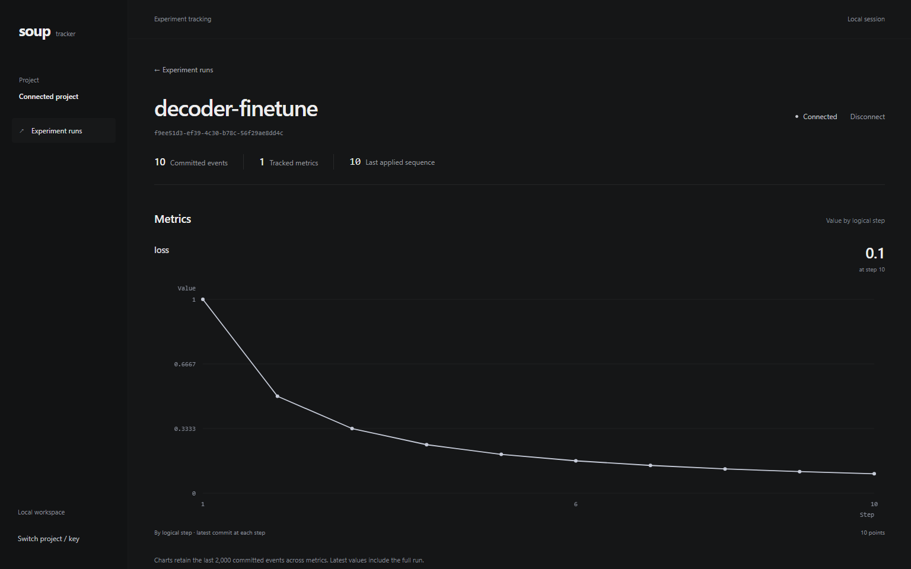

# Soup Experiment Tracker

Track experiment runs, log metric batches, and follow their history live. Reliable ingestion matters when clients retry requests or lose their connection: the tracker deduplicates events and replays committed history so the browser can recover missed updates.

## Quick start

From the repository root, with Docker running:

```sh
docker compose up
```

Open [localhost:3000](http://localhost:3000). Startup builds the images when needed, waits for PostgreSQL, and applies Alembic migrations.

Requires Docker Engine/Desktop with Linux containers and Compose v2, available ports **3000**, **8000** and **54329**, and network access for the first build. Host Python and Node.js are only needed for host-side tests.



## Features

- **Project-scoped API keys.** The bearer key determines which project's runs can be read, listed, updated or streamed.
- **Durable, idempotent ingestion.** Events, sequence counters and batch receipts commit together in PostgreSQL. Identical retries return the original receipt; conflicting payloads are rejected. Event IDs also deduplicate across batches.
- **Deterministic ordering.** A committed per-run sequence orders replay. Logical steps order the chart; the greatest `(step, seq)` determines the latest value, including late and equal-step events.
- **Recoverable live metrics.** Authenticated SSE replays stored events after the last applied cursor, including events committed between snapshot and subscription. The client reconnects after interruptions and API restarts.
- **Tenant isolation and key rotation.** Project scope applies to HTTP and SSE. Rotation invalidates old keys and terminates existing subscriptions through an independent revocation check.

## Try the browser demo

1. Click **Create project & key**, save the one-time key privately, then **Connect project**. The key field is filled automatically.
2. Enter a **New run name**, click **Create run**, and open the run.
3. Wait for **Connected**, then click **Send demo metrics**. It sends 40 generated events through the real API and updates the charts without a refresh.
4. Use **Disconnect** / **Reconnect** to pause and resume the stream. Reloading clears the in-memory key; re-enter it to view persisted runs.

The demo uses generated `demo.loss` and `demo.accuracy` samples, not ML training output. Charts show the last 2,000 events across metrics; latest values include the full run.

For your own client, create a project with `POST /projects`, create a run with `POST /runs`, and send `{batch_id, events}` to `POST /runs/{id}/metrics` using `Authorization: Bearer <key>`. Keep the same batch and event IDs when retrying. The [API contract](docs/API_CONTRACT.md) defines payloads, bounds, rotation and errors.

## Configuration and lifecycle

The browser uses **http://localhost:3000**, FastAPI **http://localhost:8000**, and PostgreSQL **127.0.0.1:54329**. The API health endpoint is `/health`. Data persists in a Docker volume; all published ports bind to loopback.

Use [.env.example](.env.example) for local port/database settings. `NEXT_PUBLIC_API_BASE_URL` must be a browser-reachable public URL and must never contain an API key. Changing the web origin also requires updating the API's `CORS_ORIGINS` in Compose.

```sh
docker compose up --build -d --wait  # Rebuild and wait for healthy services
docker compose ps                  # Inspect service health
docker compose stop                # Stop without deleting stored data
```

**`docker compose down -v` deletes the database volume.** It is not a recovery or restart command.

## Testing and measured results

| Recorded verification | Result | Raw output |
| --- | --- | --- |
| PostgreSQL-backed backend suite | 58 passed | [Backend log](artifacts/test-output/phase6-backend-tests.log) |
| Playwright after the frontend redesign | 10 passed | [Browser log](artifacts/test-output/redesign-browser-e2e-01.log) |
| Frontend parser and state tests | 5 passed | [Frontend log](artifacts/test-output/redesign-client-tests.log) |

TypeScript checks, production builds, migration checks and live HTTP/SQL smoke checks also passed. Browser tests exercise the actual Next.js UI and compare it with independent SQL after duplicates, late/out-of-order events, stream interruptions, key rotation and project switching.

Each load workload used **50 runs at a target of 10 unique events/sec per run**, batches of five, 10 seconds of warm-up and a 60-second measurement window, plus 300 identical batch retries.

| Workload | Measured metric events/sec |
| --- | ---: |
| Ingestion without SSE subscribers | 498.92 |
| Ingestion with 50 SSE subscribers | 498.17 |

Each workload stored all 35,000 planned events, including warm-up, with no HTTP failures or missing acknowledged events. **Exact 500 events/sec was not achieved.** The scoped local **SHIP** verdict uses a **self-defined 1% tolerance**, not a threshold specified by Soup. These short local measurements do not establish production capacity.

See [test instructions](docs/TESTING.md) for dependencies and commands, [execution evidence](docs/EVIDENCE.md) for environments and qualifications, and [raw results](artifacts/test-output/) for successful and failed runs. `summary.json` and `analysis.json` contain derived measurements rather than raw console output.

## Architecture and limits

FastAPI owns the API and SSE streams; Next.js App Router provides the interface. PostgreSQL is the authoritative event source, accessed through async SQLAlchemy/asyncpg with Alembic migrations. The backend uses Python 3.12 and Pydantic v2; the frontend uses React, TypeScript and Tailwind CSS.

Keys are shown once and kept only in browser memory. Do not put them in URLs, logs, screenshots, committed files or public environment variables. The included database credentials are local demo defaults. Project creation is an unauthenticated local bootstrap; production use needs an access policy and HTTPS. A lost rotation response has no automatic key recovery.

Long-running workloads with many slow SSE clients, aggregate socket memory, large-history replay and external proxies remain unverified. Generic errors and local log/timing checks do not prove that every side channel is closed.

## Further reading

- [One-page architecture](docs/DESIGN.md) ([PDF](output/pdf/Soup-Architecture.pdf))
- [Two-page submission note](output/pdf/Soup-Submission-Note.pdf) ([source](docs/SUBMISSION_NOTE.md))
- [API contract](docs/API_CONTRACT.md)
- [Test instructions](docs/TESTING.md) and [scenario matrix](docs/TEST_MATRIX.md)
- [Execution evidence](docs/EVIDENCE.md) and [requirement audit](docs/SUBMISSION_AUDIT.md)
- [How I used AI](docs/AI_USAGE.md)
- [Original assignment](reference/Soup-Full-Stack-Take-Home.pdf)
